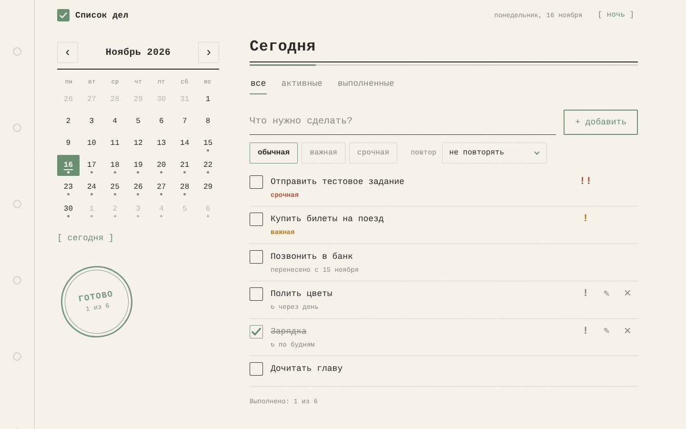
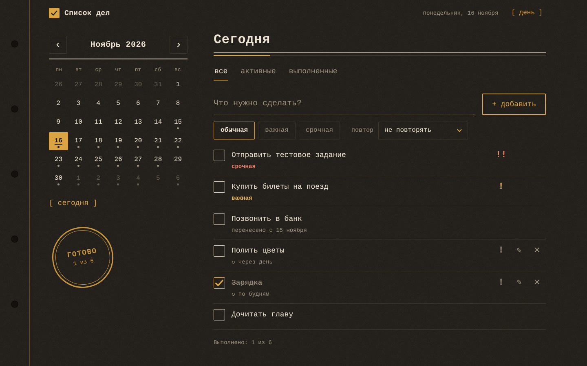
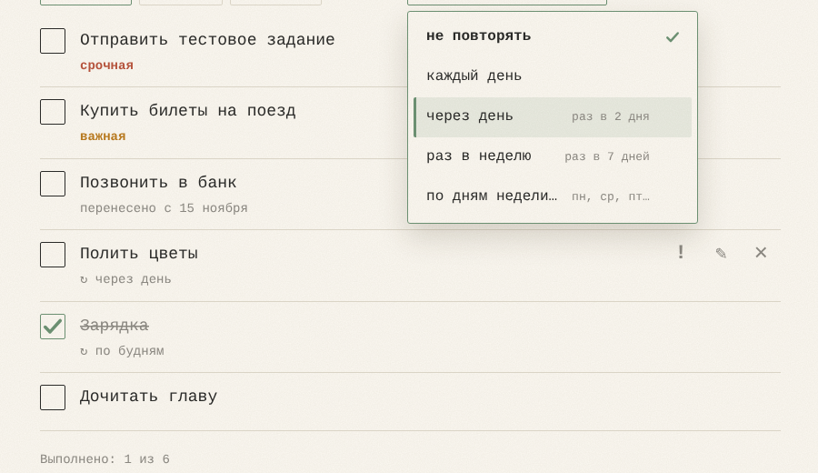
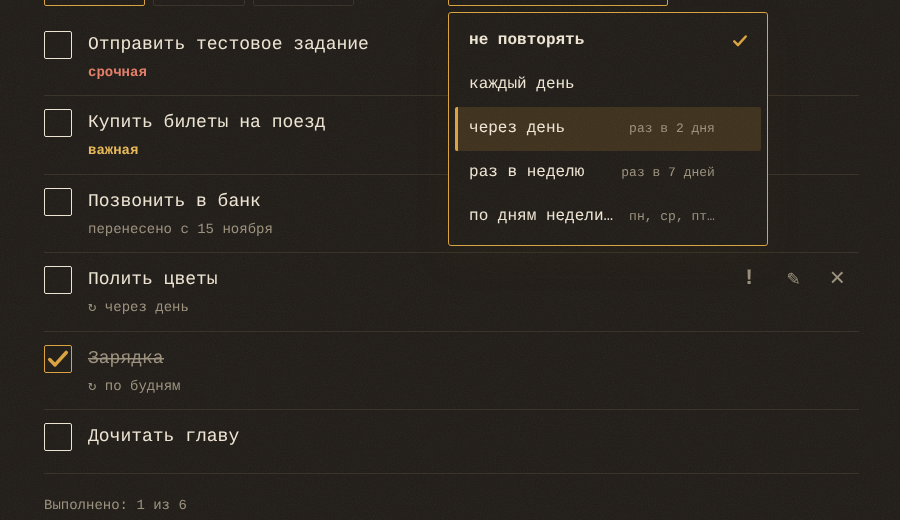
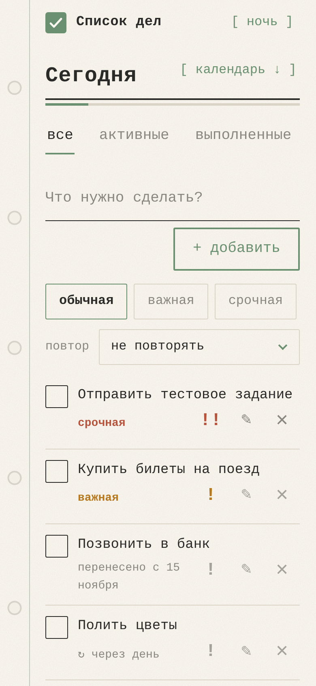
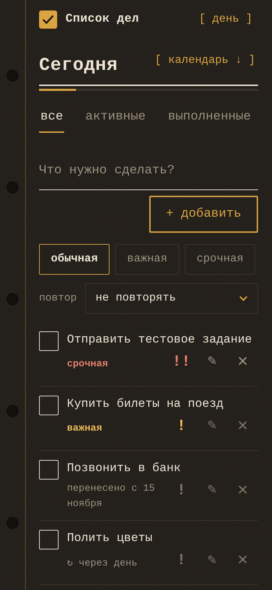

# Список дел: Typewriter Notebook

Список задач в виде листа блокнота, набранного на печатной машинке. Чистые HTML, CSS и JavaScript в одном файле, без фреймворков, сборщиков и сервера.
Проект сделан как тестовое задание по вайбкодингу: дизайн и функционал спроектированы в диалоге с ИИ (Claude), результат проверен автотестами в браузере.

**Демо:** https://shp1lman.github.io/to-do-list/

Короткая заставка с анимацией печати, которую можно пропустить кликом или любой клавишей (показывается один раз за сессию), и сразу список задач на сегодня:


| Светлая тема | Тёмная тема |
|---|---|
|  |  |

Собственный выпадающий список для повтора (не стандартный `<select>`):

| Светлая тема | Тёмная тема |
|---|---|
|  |  |

| Мобильная, светлая | Мобильная, тёмная |
|---|---|
|  |  |

## Функции

Обязательные:
- добавление задач (кнопка `+ добавить` или Enter, пустые не добавляются);
- отметка выполненной и снятие отметки;
- удаление задач;
- сохранение в LocalStorage, задачи остаются после перезагрузки.

Дополнительные:
- **отмена удаления:** 6 секунд можно вернуть задачу на прежнее место;
- **фильтры** «все / активные / выполненные»;
- **редактирование:** двойной клик по тексту или кнопка ✎, Enter сохраняет, Esc отменяет;
- **тёмная тема «Ночная библиотека»:** переключатель, запоминание выбора, учёт системной настройки без «мигания» при загрузке;
- **календарь:** месяц с точками на днях, где есть задачи (точка зеленеет, когда всё выполнено); клик по дню открывает его список, можно планировать на будущее;
- **повторяющиеся задачи:** «каждый день», «через день», «раз в неделю» или **свои дни недели** (пн, ср, пт; есть быстрые наборы «будни» и «выходные»). Достаточно создать задачу один раз: она сама появляется в нужные дни, а отметка о выполнении хранится отдельно для каждого дня;
- **перенос:** невыполненные разовые задачи прошлых дней автоматически появляются в «Сегодня» с пометкой «перенесено с …»;
- **выпадающий список в стиле сайта:** плавное открытие, подсказки к пунктам, галочка у выбранного, подсветка по наведению; полное управление с клавиатуры (стрелки, Home/End, Enter, Esc, Tab), роли ARIA `listbox/option`, открывается вверх, если внизу нет места;
- **приоритеты:** обычная, важная, срочная. Выбираются при создании, меняются кнопкой `!` в строке, срочные поднимаются вверх списка;
- счётчик «Выполнено: X из Y», полоска прогресса и штамп «ГОТОВО» с итогом за сегодня под календарём;
- **список на сегодня сразу в начале страницы**, календарь рядом (на телефоне список сверху, календарь ниже, кнопка `[ календарь ↓ ]` и автоматический возврат к списку после выбора дня);
- крупные элементы управления: области нажатия не меньше 44 px.

## Дизайн

- **Идея:** вся страница это лист блокнота: поле, дырки переплёта, бумажная текстура (SVG-шум, без картинок). Выполненное дело закрепляется штампом.
- **Шрифт:** Courier Prime (Google Fonts), запасной Courier New.
- **Светлая палитра «Шалфей и лён»:** `#F3EFE7` фон, `#FBF8F1` бумага, `#2A2A28` текст, `#6B8F71` акцент.
- **Тёмная палитра «Ночная библиотека»:** `#1E1A16` бумага, `#EDE4D3` текст, `#D9A441` янтарный акцент.
- **Анимации:** печать заголовка и задач по буквам, зачёркивание слева направо, галочка-штамп, сворачивание удаляемой строки, появление раздела при прокрутке, плавная смена темы. При включённой системной настройке «уменьшить анимации» все эффекты отключаются.
- **Адаптивность:** проверено от 320 px; календарь переходит над списком, на сенсорных экранах кнопки действий всегда видны и не уже 44 px.

## Как создавался (вайбкодинг)

Работа шла по этапам с подтверждением на каждом шаге. Это была часть исходного промпта.

1. **Постановка роли и правил.** Задача была сформулирована как «UI/UX-дизайнер и Full-Stack разработчик» с чёткими этапами и правилом не переходить дальше без подтверждения.
2. **Интервью по дизайну.** ИИ задавал вопросы по одному: стилистика, палитра, компоновка, типографика, стиль элементов, анимации. Мой выбор: минимализм с винтажным акцентом, «Шалфей и лён», «Лист блокнота», печатная машинка, живые анимации с эффектом печати. По стилю элементов предпочтений не было, и ИИ предложил вариант «Тетрадь» с машинописной деталью.
3. **Концепция и ТЗ.** Структура страницы, палитра, шрифты, отступы, компоненты, список функций и явно перечисленное «не включено». Я подтвердил его перед разработкой.
4. **Разработка** в одном `index.html`.
5. **Итерации по моей обратной связи:**
   - «растянуть на всю страницу, больше анимаций, чтобы было похоже на сайт» привело к полноэкранному листу, верхней панели, первому экрану с печатающимся заголовком и штампом-счётчиком;
   - для портфолио добавил тёмную тему, фильтры, редактирование и отмену удаления;
   - «задачи на сегодня в самом начале, надпись превью, выбор дней повторения» привели к замене большого первого экрана короткой заставкой и к повтору по дням недели;
   - «календарь, повторяющиеся задачи, приоритеты, кнопки побольше» привели к смене модели данных (даты, правило повтора, приоритет) и новой раскладке с календарём слева.
6. **Проверка.** Автотесты в headless Chromium (Playwright) прогонялись после каждой версии. Тесты нашли и помогли исправить реальную проблему: на 320 px поле ввода было слишком узким.

### Что проверено

Добавление (в том числе пустых и из пробелов), отметка и снятие, удаление, отмена удаления, сохранение после перезагрузки, фильтры, редактирование (Enter, Esc, пустое значение, потеря фокуса), приоритеты и сортировка, выпадающий список (мышь, клавиатура, закрытие по клику снаружи и Esc, сброс после добавления, помещается в экран на 320 px), календарь и переключение дней, правила повтора, включая дни недели (проверены 15 дней подряд; без выбранных дней задача не создаётся и текст не теряется), заставка и её пропуск, расположение списка выше календаря на телефоне, правила повтора («через день» не показывается на следующий день, но показывается на +2 и +4 день, отметка на один день не влияет на другие), перенос невыполненных задач, размеры областей нажатия, миграция данных старого формата, устойчивость к повреждённому LocalStorage, защита от XSS (текст вставляется как текст), тёмная тема и её сохранение, учёт системной темы, отсутствие горизонтальной прокрутки на 320 px, отсутствие ошибок JavaScript.

## Как устроен код

Всё в `index.html`, три логических блока:

- **CSS:** переменные цветов в `:root`, тёмная тема переопределяет их в `:root[data-theme="dark"]`. Имя `--sage` хранит акцентный цвет темы.
- **Данные:** массив `tasks` из объектов `{ id, text, done, doneDate, priority, date, repeat, days, doneOn }`. Повторяющаяся задача хранится один раз, а `entriesFor(день)` вычисляет, какие задачи относятся к дню, по правилу `(день − date) % repeat === 0` или по дню недели из `days`. Данные старого формата (без дат и приоритетов) подхватываются автоматически. Функции `load()` и `save()` работают с LocalStorage (ключ `typewriter-todo.tasks.v1`), обёрнуты в `try/catch` и проверяют формат данных.
- **Выпадающий список:** настоящий скрытый `<select>` хранит значение (форма и логика не меняются), а поверх него отрисован собственный интерфейс; список пунктов строится из `<option>`, поэтому источник данных один.
- **Интерфейс:** `makeItem()` создаёт строку, `renderAll()` перерисовывает список выбранного дня и календарь, `updateMeta()` обновляет счётчик, прогресс, штамп и пустое состояние. Действия (`addTask`, `toggleTask`, `removeTask`, `startEdit`) меняют массив, сохраняют его и обновляют DOM. Обработчики вешаются на список один раз (делегирование событий).

## Запуск

Откройте `index.html` двойным кликом в любом современном браузере. Сервер и сборка не нужны.
Для загрузки шрифта нужен интернет, без него используется Courier New.

## Структура проекта

```
index.html    приложение: разметка, стили, скрипт
README.md     описание
*.png         скриншоты для README
```

## Публикация на GitHub Pages

1. Создайте публичный репозиторий и загрузите в него файлы проекта.
2. Settings, затем Pages. Source: Deploy from a branch, ветка `main`, папка `/ (root)`, Save.
3. Через 1–2 минуты сайт откроется по адресу `https://shp1lman.github.io/to-do-list/`.

## Технологии

HTML5, CSS3 (переменные, grid, `backdrop-filter`, анимации), JavaScript (LocalStorage, IntersectionObserver, делегирование событий).
